# Fork features

What this fork of Thunderbird for Android adds on top of [upstream](https://github.com/thunderbird/thunderbird-android).
It lists features and notable fixes built here, grouped by area, newest first within each area, with the commits
that made them. Bug fixes to the fork's own features are folded into the feature they fix; refactors, test-only
commits and CI fixes are left out.

Kept up to date as work lands: every change that adds or changes a user-visible feature updates this file in the same
push. See "Fork features log" in [AGENTS.md](AGENTS.md).

Last updated: 2026-11-08 · upstream merged up to its main branch of 2026-11-05 (`467787f`, versionName 27.0)

## Contents

- [Microsoft 365 (Graph backend)](#microsoft-365-graph-backend)
- [Spam: digest, alerts and rescue](#spam-digest-alerts-and-rescue)
- [Newsletters and bulk senders](#newsletters-and-bulk-senders)
- [Phishing and impersonation protection](#phishing-and-impersonation-protection)
- [Sender pictures and verified logos](#sender-pictures-and-verified-logos)
- [Mail categories](#mail-categories)
- [Message list, folders and search](#message-list-folders-and-search)
- [Message view](#message-view)
- [Packages and trips](#packages-and-trips)
- [Composing and sending](#composing-and-sending)
- [Notifications](#notifications)
- [Home screen widgets](#home-screen-widgets)
- [Settings](#settings)
- [Builds and releases](#builds-and-releases)
- [Screenshots](#screenshots)

## Microsoft 365 (Graph backend)

Microsoft 365 accounts work through Microsoft Graph instead of IMAP/SMTP, which many tenants disable.

|    Date    |                                                                                         Feature                                                                                         |                                                                                                                                                                                                                                                                                                                     Commits                                                                                                                                                                                                                                                                                                                     |
|------------|-----------------------------------------------------------------------------------------------------------------------------------------------------------------------------------------|-------------------------------------------------------------------------------------------------------------------------------------------------------------------------------------------------------------------------------------------------------------------------------------------------------------------------------------------------------------------------------------------------------------------------------------------------------------------------------------------------------------------------------------------------------------------------------------------------------------------------------------------------|
| 2026-10-04 | Messages keep the time the mailbox received them, so date-based features (spam digest, sort by arrival) see the right day.                                                              | [`d1e39b4`](https://github.com/bobcat0070/thunderbird-android/commit/d1e39b4)                                                                                                                                                                                                                                                                                                                                                                                                                                                                                                                                                                   |
| 2026-10-02 | Messages are identified by Outlook's immutable IDs, so a message moved in Outlook or the app keeps its stored body and identity; existing folders are converted once.                   | [`daa9ad4`](https://github.com/bobcat0070/thunderbird-android/commit/daa9ad4) [`d27fb1c`](https://github.com/bobcat0070/thunderbird-android/commit/d27fb1c) [`3ba7b52`](https://github.com/bobcat0070/thunderbird-android/commit/3ba7b52)                                                                                                                                                                                                                                                                                                                                                                                                       |
| 2026-10-01 | Outlook categories and importance sync both ways: shown in the list and message view, categories can be assigned, importance can be set when composing.                                 | [`2b9343e`](https://github.com/bobcat0070/thunderbird-android/commit/2b9343e) [`68d6c0a`](https://github.com/bobcat0070/thunderbird-android/commit/68d6c0a) [`30704fd`](https://github.com/bobcat0070/thunderbird-android/commit/30704fd) [`6f360b4`](https://github.com/bobcat0070/thunderbird-android/commit/6f360b4) [`a0fe529`](https://github.com/bobcat0070/thunderbird-android/commit/a0fe529) [`2e1b56d`](https://github.com/bobcat0070/thunderbird-android/commit/2e1b56d) [`2f9bbd3`](https://github.com/bobcat0070/thunderbird-android/commit/2f9bbd3) [`69f5f40`](https://github.com/bobcat0070/thunderbird-android/commit/69f5f40) |
| 2026-09-28 | Replied and forwarded state syncs with Outlook, including for mail stored earlier.                                                                                                      | [`d40a141`](https://github.com/bobcat0070/thunderbird-android/commit/d40a141) [`fe43bb3`](https://github.com/bobcat0070/thunderbird-android/commit/fe43bb3) [`07a2d81`](https://github.com/bobcat0070/thunderbird-android/commit/07a2d81) [`a3298fe`](https://github.com/bobcat0070/thunderbird-android/commit/a3298fe)                                                                                                                                                                                                                                                                                                                         |
| 2026-09-28 | Requests that hang are given up on after two minutes; delta sync no longer sends a query Microsoft rejects; contacts come from the default contacts folder.                             | [`ad60f60`](https://github.com/bobcat0070/thunderbird-android/commit/ad60f60) [`c26c505`](https://github.com/bobcat0070/thunderbird-android/commit/c26c505) [`0968920`](https://github.com/bobcat0070/thunderbird-android/commit/0968920)                                                                                                                                                                                                                                                                                                                                                                                                       |
| 2026-09-27 | Searching everywhere searches the whole mailbox in one request, and saves what it finds without duplicating mail already on the device.                                                 | [`4a022e0`](https://github.com/bobcat0070/thunderbird-android/commit/4a022e0) [`1b4e6fa`](https://github.com/bobcat0070/thunderbird-android/commit/1b4e6fa)                                                                                                                                                                                                                                                                                                                                                                                                                                                                                     |
| 2026-09-26 | Large attachments are sent and saved; sent mail is not uploaded twice; failed changes are kept for retry; large and unlimited sync counts are honoured.                                 | [`edc7a8e`](https://github.com/bobcat0070/thunderbird-android/commit/edc7a8e) [`d3a969e`](https://github.com/bobcat0070/thunderbird-android/commit/d3a969e) [`b3f0c13`](https://github.com/bobcat0070/thunderbird-android/commit/b3f0c13) [`b0f7cc7`](https://github.com/bobcat0070/thunderbird-android/commit/b0f7cc7)                                                                                                                                                                                                                                                                                                                         |
| 2026-09-03 | A message's body is downloaded when it is opened. Since 2026-11-01 downloading keeps whether it was read, starred, replied to or forwarded.                                             | [`ec0b97c`](https://github.com/bobcat0070/thunderbird-android/commit/ec0b97c) [`0fda9a6`](https://github.com/bobcat0070/thunderbird-android/commit/0fda9a6)                                                                                                                                                                                                                                                                                                                                                                                                                                                                                     |
| 2026-09-02 | The Graph backend itself: Microsoft 365 mailboxes are detected during setup and use Graph, with its OAuth configuration. ADR in `docs/engineering/adr/0010-microsoft-graph-backend.md`. | [`39819f6`](https://github.com/bobcat0070/thunderbird-android/commit/39819f6) [`eaa711a`](https://github.com/bobcat0070/thunderbird-android/commit/eaa711a) [`30f1af4`](https://github.com/bobcat0070/thunderbird-android/commit/30f1af4) [`e64e0ab`](https://github.com/bobcat0070/thunderbird-android/commit/e64e0ab) [`99614f4`](https://github.com/bobcat0070/thunderbird-android/commit/99614f4) [`b043fb6`](https://github.com/bobcat0070/thunderbird-android/commit/b043fb6)                                                                                                                                                             |

## Spam: digest, alerts and rescue

|    Date    |                                                                                                                                                                                                                                                                       Feature                                                                                                                                                                                                                                                                       |                                                                                                                                                         Commits                                                                                                                                                         |
|------------|-----------------------------------------------------------------------------------------------------------------------------------------------------------------------------------------------------------------------------------------------------------------------------------------------------------------------------------------------------------------------------------------------------------------------------------------------------------------------------------------------------------------------------------------------------|-------------------------------------------------------------------------------------------------------------------------------------------------------------------------------------------------------------------------------------------------------------------------------------------------------------------------|
| 2026-10-12 | **Send digest now** and **Recent digest runs** in Settings → account → Spam: send a digest on demand, and see what each run did, to the second (spam folders read and what they held, messages sent and for which days, how long the server took, nothing due, failed or stopped by Android and why, the next alarm and whether it is exact). A digest waiting to run is no longer cancelled by each mail check, and the digest is sent straight to the server from its run, so one the server does not take is retried instead of counted as sent. | [`1ebca2f`](https://github.com/bobcat0070/thunderbird-android/commit/1ebca2f) [`d58f074`](https://github.com/bobcat0070/thunderbird-android/commit/d58f074) [`3a88f60`](https://github.com/bobcat0070/thunderbird-android/commit/3a88f60) [`1857a4b`](https://github.com/bobcat0070/thunderbird-android/commit/1857a4b) |
| 2026-10-10 | A digest that does not go out is caught up: the next one, or the next app start or mail check, covers every day since the last digest sent (up to a week), with each day's spam under its own heading.                                                                                                                                                                                                                                                                                                                                              | [`fc93404`](https://github.com/bobcat0070/thunderbird-android/commit/fc93404)                                                                                                                                                                                                                                           |
| 2026-10-04 | **Daily spam digest.** One account emails itself a plain-text list of the previous day's spam from every included account: sender name, address with SPF/DKIM/DMARC alignment, and subject. Set up in each account's settings under Spam.                                                                                                                                                                                                                                                                                                           | [`694fb9e`](https://github.com/bobcat0070/thunderbird-android/commit/694fb9e)                                                                                                                                                                                                                                           |
| 2026-10-04 | Digest sent at the chosen time by an alarm (with a prompt to allow exact alarms), restored after a reboot, and sent late rather than skipped if the phone was off.                                                                                                                                                                                                                                                                                                                                                                                  | [`da19595`](https://github.com/bobcat0070/thunderbird-android/commit/da19595) [`d05afd6`](https://github.com/bobcat0070/thunderbird-android/commit/d05afd6)                                                                                                                                                             |
| 2026-10-04 | Choose what the digest shows: sender name, address, sender checks, subject.                                                                                                                                                                                                                                                                                                                                                                                                                                                                         | [`34fb30e`](https://github.com/bobcat0070/thunderbird-android/commit/34fb30e)                                                                                                                                                                                                                                           |
| 2026-10-04 | **Possibly not spam.** Mail in spam from people you have written to or have as contacts is listed first in the digest - never if it failed DMARC or impersonates them.                                                                                                                                                                                                                                                                                                                                                                              | [`8cf120d`](https://github.com/bobcat0070/thunderbird-android/commit/8cf120d)                                                                                                                                                                                                                                           |
| 2026-10-04 | **Spam alert.** Optional per account: a notification as soon as mail from someone you know lands in spam. Turns on background checking of the spam folder.                                                                                                                                                                                                                                                                                                                                                                                          | [`8cf120d`](https://github.com/bobcat0070/thunderbird-android/commit/8cf120d) [`376b9d2`](https://github.com/bobcat0070/thunderbird-android/commit/376b9d2)                                                                                                                                                             |
| 2026-10-04 | Spam digest and alert settings are included in settings export.                                                                                                                                                                                                                                                                                                                                                                                                                                                                                     | [`da19595`](https://github.com/bobcat0070/thunderbird-android/commit/da19595)                                                                                                                                                                                                                                           |

## Newsletters and bulk senders

|    Date    |                                                                                                                                                            Feature                                                                                                                                                            |                                                                           Commits                                                                           |
|------------|-------------------------------------------------------------------------------------------------------------------------------------------------------------------------------------------------------------------------------------------------------------------------------------------------------------------------------|-------------------------------------------------------------------------------------------------------------------------------------------------------------|
| 2026-10-06 | All mail from this sender searches the server by itself when it opens, for every match rather than the first 25, and says under the address how it went: searching, how many more were added, nothing more, offline or failed. Since 2026-11-06 the list no longer adds a "Fetching 0 results" line for each folder searched. | [`1b4e6fa`](https://github.com/bobcat0070/thunderbird-android/commit/1b4e6fa) [`c643883`](https://github.com/bobcat0070/thunderbird-android/commit/c643883) |
| 2026-10-04 | **Manage newsletters.** From the Newsletters category, a screen listing newsletter senders by volume, each with Unsubscribe, Archive all and Delete all.                                                                                                                                                                      | [`fcb0e9a`](https://github.com/bobcat0070/thunderbird-android/commit/fcb0e9a)                                                                               |
| 2026-10-04 | **All mail from this sender.** From any message, a list of everything that sender sent, across accounts (Trash and Spam excluded), with Archive all, Delete all and Unsubscribe.                                                                                                                                              | [`b15abbe`](https://github.com/bobcat0070/thunderbird-android/commit/b15abbe) [`f922387`](https://github.com/bobcat0070/thunderbird-android/commit/f922387) |
| 2026-10-04 | One-click unsubscribe (RFC 8058) sent from the app when the sender supports it, falling back to their page or address.                                                                                                                                                                                                        | [`f922387`](https://github.com/bobcat0070/thunderbird-android/commit/f922387)                                                                               |
| 2026-09-06 | Unsubscribe from the message list without opening the message.                                                                                                                                                                                                                                                                | [`2edd602`](https://github.com/bobcat0070/thunderbird-android/commit/2edd602)                                                                               |

## Phishing and impersonation protection

|    Date    |                                                                                                                                                                                                                                                                                                                                                                                                              Feature                                                                                                                                                                                                                                                                                                                                                                                                              |                                                                                                                                                                                                Commits                                                                                                                                                                                                |
|------------|-----------------------------------------------------------------------------------------------------------------------------------------------------------------------------------------------------------------------------------------------------------------------------------------------------------------------------------------------------------------------------------------------------------------------------------------------------------------------------------------------------------------------------------------------------------------------------------------------------------------------------------------------------------------------------------------------------------------------------------------------------------------------------------------------------------------------------------|-------------------------------------------------------------------------------------------------------------------------------------------------------------------------------------------------------------------------------------------------------------------------------------------------------------------------------------------------------------------------------------------------------|
| 2026-10-24 | **DNS blocklist notes.** A sender whose domain, or a link whose site, is on the HaGeZi DNS blocklist you choose gets a note: a line under the sender, an icon in the message list, a line in the link dialog. Red for HaGeZi's threat list (malware, phishing, scams), quieter for the general list. Nothing is blocked. Settings → General settings → Interaction → **Domain blocklist** (Off, Light, **Normal**, Pro, Pro++, Ultimate) and **Threat list** (on). The lists are downloaded daily on Wi-Fi and every check is made on the device. Also checked: the site behind a Safe Links or other redirect, the domains the server verified a message was sent through, new-mail notifications (⚠ for threat-listed senders) and the spam digest, which never lists a threat-listed sender as possibly not spam (2026-10-25). | [`09d9b95`](https://github.com/bobcat0070/thunderbird-android/commit/09d9b95) [`93fc0d7`](https://github.com/bobcat0070/thunderbird-android/commit/93fc0d7)                                                                                                                                                                                                                                           |
| 2026-10-04 | **Lookalike-sender warning.** A warning under the sender when a message impersonates someone you know: your contact's name on a stranger's address, a domain made to look like one you get verified mail from (`paypa1.com`, mixed alphabets), or an address written into the display name. Domains count as verified from a nightly scan (about 3 AM) rather than one every half hour, which made a message list load slowly now and then (2026-10-18). A display name of any length is checked without stalling or crashing; only its first 256 characters are examined (2026-10-24).                                                                                                                                                                                                                                           | [`022b612`](https://github.com/bobcat0070/thunderbird-android/commit/022b612) [`8cf120d`](https://github.com/bobcat0070/thunderbird-android/commit/8cf120d) [`17e5ab1`](https://github.com/bobcat0070/thunderbird-android/commit/17e5ab1) [`29ba7be`](https://github.com/bobcat0070/thunderbird-android/commit/29ba7be) [`84ca5a7`](https://github.com/bobcat0070/thunderbird-android/commit/84ca5a7) |
| 2026-10-04 | The same warning as a ⚠ in the message list and at the top of new-mail notifications; checking for it no longer slows down opening a large list.                                                                                                                                                                                                                                                                                                                                                                                                                                                                                                                                                                                                                                                                                  | [`883c12d`](https://github.com/bobcat0070/thunderbird-android/commit/883c12d) [`c957b19`](https://github.com/bobcat0070/thunderbird-android/commit/c957b19) [`dcea26e`](https://github.com/bobcat0070/thunderbird-android/commit/dcea26e)                                                                                                                                                             |
| 2026-10-04 | Microsoft's sender checks are trusted when its header names its server (`mx.microsoft.com`), which it does on about one message in eight.                                                                                                                                                                                                                                                                                                                                                                                                                                                                                                                                                                                                                                                                                         | [`08bc740`](https://github.com/bobcat0070/thunderbird-android/commit/08bc740)                                                                                                                                                                                                                                                                                                                         |
| 2026-09-27 | Warning before opening a link whose text names a different site than it opens; since 2026-10-24 shown in the link check dialog (see Message view). Since 2026-11-01 every link check - this warning, the threat list, sign-in links, redirect destinations and tracking pixels - judges a link by the site a browser opens, so `https://evil.example\@paypal.com/`, `https:evil.example` and similar spellings no longer pass for another site.                                                                                                                                                                                                                                                                                                                                                                                   | [`c0803fe`](https://github.com/bobcat0070/thunderbird-android/commit/c0803fe) [`ae8098c`](https://github.com/bobcat0070/thunderbird-android/commit/ae8098c)                                                                                                                                                                                                                                           |
| 2026-09-26 | Only the account's own server's sender verdict is believed; sender-chosen URLs are kept off the local network; downloaded pictures are bounded, Gravatar pictures and revocation lists too since 2026-11-01; senders are kept out of logs.                                                                                                                                                                                                                                                                                                                                                                                                                                                                                                                                                                                        | [`d4ef0f4`](https://github.com/bobcat0070/thunderbird-android/commit/d4ef0f4) [`c49d991`](https://github.com/bobcat0070/thunderbird-android/commit/c49d991) [`9e1d5fa`](https://github.com/bobcat0070/thunderbird-android/commit/9e1d5fa) [`05dbba5`](https://github.com/bobcat0070/thunderbird-android/commit/05dbba5) [`ff152ad`](https://github.com/bobcat0070/thunderbird-android/commit/ff152ad) |
| 2026-09-19 | Trusting all remote images from a domain requires the message to pass DMARC.                                                                                                                                                                                                                                                                                                                                                                                                                                                                                                                                                                                                                                                                                                                                                      | [`f554427`](https://github.com/bobcat0070/thunderbird-android/commit/f554427)                                                                                                                                                                                                                                                                                                                         |
| 2026-09-03 | Always load remote images from senders you trust.                                                                                                                                                                                                                                                                                                                                                                                                                                                                                                                                                                                                                                                                                                                                                                                 | [`44f6ad3`](https://github.com/bobcat0070/thunderbird-android/commit/44f6ad3)                                                                                                                                                                                                                                                                                                                         |

## Sender pictures and verified logos

|    Date    |                                                                                                                                                                                         Feature                                                                                                                                                                                          |                                                                                                                                                                                                                                                                              Commits                                                                                                                                                                                                                                                                              |
|------------|------------------------------------------------------------------------------------------------------------------------------------------------------------------------------------------------------------------------------------------------------------------------------------------------------------------------------------------------------------------------------------------|-------------------------------------------------------------------------------------------------------------------------------------------------------------------------------------------------------------------------------------------------------------------------------------------------------------------------------------------------------------------------------------------------------------------------------------------------------------------------------------------------------------------------------------------------------------------|
| 2026-09-26 | Sender pictures in category rows, widgets and notifications; only cached pictures used where speed matters; failing lookups paused.                                                                                                                                                                                                                                                      | [`e9b9bb0`](https://github.com/bobcat0070/thunderbird-android/commit/e9b9bb0) [`cde0f06`](https://github.com/bobcat0070/thunderbird-android/commit/cde0f06) [`c775bff`](https://github.com/bobcat0070/thunderbird-android/commit/c775bff)                                                                                                                                                                                                                                                                                                                         |
| 2026-09-18 | Logos shown square, initials round.                                                                                                                                                                                                                                                                                                                                                      | [`126863f`](https://github.com/bobcat0070/thunderbird-android/commit/126863f)                                                                                                                                                                                                                                                                                                                                                                                                                                                                                     |
| 2026-09-07 | The message view says where a sender picture came from and which checks the receiving server reported.                                                                                                                                                                                                                                                                                   | [`0f2f44c`](https://github.com/bobcat0070/thunderbird-android/commit/0f2f44c)                                                                                                                                                                                                                                                                                                                                                                                                                                                                                     |
| 2026-09-04 | The sender website's icon as a fallback, when enabled.                                                                                                                                                                                                                                                                                                                                   | [`9ce0571`](https://github.com/bobcat0070/thunderbird-android/commit/9ce0571)                                                                                                                                                                                                                                                                                                                                                                                                                                                                                     |
| 2026-09-03 | **Verified brand logos (BIMI)**, only for mail that passed DMARC, with mark-authority verification, revocation checks and a cache that survives restarts. A logo that is gzipped or not plain UTF-8 is refused, so nothing can get past the check for embedded images and entities (2026-11-01). A mark carried in the certificate is refused past 64 KB once decompressed (2026-11-08). | [`f2451bf`](https://github.com/bobcat0070/thunderbird-android/commit/f2451bf) [`fed6aa1`](https://github.com/bobcat0070/thunderbird-android/commit/fed6aa1) [`7224c7e`](https://github.com/bobcat0070/thunderbird-android/commit/7224c7e) [`c6b7484`](https://github.com/bobcat0070/thunderbird-android/commit/c6b7484) [`6e03395`](https://github.com/bobcat0070/thunderbird-android/commit/6e03395) [`db9cada`](https://github.com/bobcat0070/thunderbird-android/commit/db9cada) [`df360e8`](https://github.com/bobcat0070/thunderbird-android/commit/df360e8) |
| 2026-09-02 | Sender pictures from Gravatar.                                                                                                                                                                                                                                                                                                                                                           | [`3f039e4`](https://github.com/bobcat0070/thunderbird-android/commit/3f039e4) [`7803d7b`](https://github.com/bobcat0070/thunderbird-android/commit/7803d7b)                                                                                                                                                                                                                                                                                                                                                                                                       |

## Mail categories

Mail is classified as personal, notification or newsletter.

|    Date    |                                                                      Feature                                                                       |                                                                                                                                                                                                                                       Commits                                                                                                                                                                                                                                       |
|------------|----------------------------------------------------------------------------------------------------------------------------------------------------|-------------------------------------------------------------------------------------------------------------------------------------------------------------------------------------------------------------------------------------------------------------------------------------------------------------------------------------------------------------------------------------------------------------------------------------------------------------------------------------|
| 2026-09-26 | Mail Microsoft's Focused Inbox puts in Other is filed with the newsletters.                                                                        | [`7050850`](https://github.com/bobcat0070/thunderbird-android/commit/7050850)                                                                                                                                                                                                                                                                                                                                                                                                       |
| 2026-09-26 | Each folder can keep its own category grouping, set in its folder settings.                                                                        | [`c040c66`](https://github.com/bobcat0070/thunderbird-android/commit/c040c66) [`0be8bb1`](https://github.com/bobcat0070/thunderbird-android/commit/0be8bb1)                                                                                                                                                                                                                                                                                                                         |
| 2026-09-06 | Shows why a message was filed where it was; applies taught corrections to existing mail.                                                           | [`87f71fc`](https://github.com/bobcat0070/thunderbird-android/commit/87f71fc) [`cf299bc`](https://github.com/bobcat0070/thunderbird-android/commit/cf299bc)                                                                                                                                                                                                                                                                                                                         |
| 2026-09-03 | Uses your contacts and correspondence (written to twice or more); shows and undoes what you taught; stored mail is reclassified when rules change. | [`b7b66a6`](https://github.com/bobcat0070/thunderbird-android/commit/b7b66a6) [`ea16ec1`](https://github.com/bobcat0070/thunderbird-android/commit/ea16ec1) [`81b60de`](https://github.com/bobcat0070/thunderbird-android/commit/81b60de) [`f4a2aab`](https://github.com/bobcat0070/thunderbird-android/commit/f4a2aab) [`c405dd5`](https://github.com/bobcat0070/thunderbird-android/commit/c405dd5) [`d15521a`](https://github.com/bobcat0070/thunderbird-android/commit/d15521a) |
| 2026-09-02 | Classification, teaching a correction, and bundling bulk mail into pinned category rows that open as their own list.                               | [`44eeb6b`](https://github.com/bobcat0070/thunderbird-android/commit/44eeb6b) [`75322ae`](https://github.com/bobcat0070/thunderbird-android/commit/75322ae) [`18651a9`](https://github.com/bobcat0070/thunderbird-android/commit/18651a9) [`00fb236`](https://github.com/bobcat0070/thunderbird-android/commit/00fb236)                                                                                                                                                             |

## Message list, folders and search

|    Date    |                                                                                                                                                                                                                                    Feature                                                                                                                                                                                                                                     |                                                                                                                                                                                                Commits                                                                                                                                                                                                |
|------------|--------------------------------------------------------------------------------------------------------------------------------------------------------------------------------------------------------------------------------------------------------------------------------------------------------------------------------------------------------------------------------------------------------------------------------------------------------------------------------|-------------------------------------------------------------------------------------------------------------------------------------------------------------------------------------------------------------------------------------------------------------------------------------------------------------------------------------------------------------------------------------------------------|
| 2026-11-06 | Syncing no longer slows down for the drawer: a unified folder's counts are recounted only when one of its own folders changes, and the recount runs in the background rather than on the thread doing the sync.                                                                                                                                                                                                                                                                | [`c9af0ea`](https://github.com/bobcat0070/thunderbird-android/commit/c9af0ea) [`cd1223f`](https://github.com/bobcat0070/thunderbird-android/commit/cd1223f)                                                                                                                                                                                                                                           |
| 2026-11-01 | **Attachments from a sender.** **Attachments** in the menu of All mail from this sender lists every file that sender sent, across accounts (Trash and Spam excluded): name, size, date and subject, newest first. Tap a file to open it (downloaded first if needed); the envelope button opens its message. Microsoft 365 mail that has not been opened yet is counted above the list, with a button that downloads 25 such messages at a time so their files are listed too. | [`a7b3b1b`](https://github.com/bobcat0070/thunderbird-android/commit/a7b3b1b)                                                                                                                                                                                                                                                                                                                         |
| 2026-10-08 | **Undo for delete and move.** Deleting, archiving, marking as spam or moving mail, from the list or an open message, shows "Undo" at the bottom of the screen for 3 seconds; nothing happens to the mail until then.                                                                                                                                                                                                                                                           | [`a83ad9e`](https://github.com/bobcat0070/thunderbird-android/commit/a83ad9e) [`32d6b81`](https://github.com/bobcat0070/thunderbird-android/commit/32d6b81)                                                                                                                                                                                                                                           |
| 2026-10-06 | Selected mail moves to a pinned folder in one tap ("Move to <folder>" in the selection toolbar), or to any folder from Move, also in lists that span accounts when the selection is from one. Rows name their folder when a list mixes folders, as a sender's list or a search can; a unified inbox's inboxes do not count as mixed.                                                                                                                                           | [`1bcad73`](https://github.com/bobcat0070/thunderbird-android/commit/1bcad73) [`8818bb3`](https://github.com/bobcat0070/thunderbird-android/commit/8818bb3)                                                                                                                                                                                                                                           |
| 2026-09-28 | Newest messages shown first while the rest load; switching folders without a blank screen; the list loads once at a time while mail is being saved; an older message opens instead of closing at once; going back to the list from a message, after deleting or moving it, keeps the list's place.                                                                                                                                                                             | [`04a599e`](https://github.com/bobcat0070/thunderbird-android/commit/04a599e) [`95a7a45`](https://github.com/bobcat0070/thunderbird-android/commit/95a7a45) [`e2d2bc8`](https://github.com/bobcat0070/thunderbird-android/commit/e2d2bc8) [`b24f024`](https://github.com/bobcat0070/thunderbird-android/commit/b24f024) [`98ae72e`](https://github.com/bobcat0070/thunderbird-android/commit/98ae72e) |
| 2026-09-28 | The Sent folder syncs in the background.                                                                                                                                                                                                                                                                                                                                                                                                                                       | [`666b08f`](https://github.com/bobcat0070/thunderbird-android/commit/666b08f)                                                                                                                                                                                                                                                                                                                         |
| 2026-09-24 | Unified Sent, Drafts, Archive, Spam and Trash in the drawer; folders can be pinned. Switching to the unified account from an account's view updates the drawer too (2026-10-17). Since 2026-11-06 the unified folders are upstream's own, Outbox included, and the unified inbox is every account's inbox (the per-folder "Unify" switch is gone); pinned folders stay.                                                                                                        | [`68c7d9b`](https://github.com/bobcat0070/thunderbird-android/commit/68c7d9b) [`712c15e`](https://github.com/bobcat0070/thunderbird-android/commit/712c15e) [`5169202`](https://github.com/bobcat0070/thunderbird-android/commit/5169202)                                                                                                                                                             |
| 2026-09-06 | Pin the folders you file into and move there in one tap from the toolbar.                                                                                                                                                                                                                                                                                                                                                                                                      | [`a760cf9`](https://github.com/bobcat0070/thunderbird-android/commit/a760cf9) [`d9f2627`](https://github.com/bobcat0070/thunderbird-android/commit/d9f2627)                                                                                                                                                                                                                                           |
| 2026-09-06 | Server search from the unified inbox and across every folder.                                                                                                                                                                                                                                                                                                                                                                                                                  | [`85c870d`](https://github.com/bobcat0070/thunderbird-android/commit/85c870d)                                                                                                                                                                                                                                                                                                                         |
| 2026-09-04 | A category list stays inside the folders it was opened from.                                                                                                                                                                                                                                                                                                                                                                                                                   | [`12aa406`](https://github.com/bobcat0070/thunderbird-android/commit/12aa406)                                                                                                                                                                                                                                                                                                                         |
| 2026-09-03 | Grouping toggle and day headers in the message list.                                                                                                                                                                                                                                                                                                                                                                                                                           | [`9943490`](https://github.com/bobcat0070/thunderbird-android/commit/9943490)                                                                                                                                                                                                                                                                                                                         |

## Message view

|    Date    |                                                                                                                                                                                                                                                                                                                                                                                                                                                                                                            Feature                                                                                                                                                                                                                                                                                                                                                                                                                                                                                                             |                                                                                                                                                                                                                                                                              Commits                                                                                                                                                                                                                                                                              |
|------------|--------------------------------------------------------------------------------------------------------------------------------------------------------------------------------------------------------------------------------------------------------------------------------------------------------------------------------------------------------------------------------------------------------------------------------------------------------------------------------------------------------------------------------------------------------------------------------------------------------------------------------------------------------------------------------------------------------------------------------------------------------------------------------------------------------------------------------------------------------------------------------------------------------------------------------------------------------------------------------------------------------------------------------|-------------------------------------------------------------------------------------------------------------------------------------------------------------------------------------------------------------------------------------------------------------------------------------------------------------------------------------------------------------------------------------------------------------------------------------------------------------------------------------------------------------------------------------------------------------------|
| 2026-11-01 | **Track packages.** A shipping mail with a UPS, USPS, FedEx or DHL tracking number shows **Track UPS package 1Z…** under the sender, opening the carrier's own tracking page instead of the sender's tracked link - straight away since 2026-11-08, as the app builds the page itself and the link check has nothing to judge. A number counts only when it passes the carrier's check digit in a mail about shipping; FedEx and DHL numbers must also stand next to the carrier's name.                                                                                                                                                                                                                                                                                                                                                                                                                                                                                                                                       | [`b137f31`](https://github.com/bobcat0070/thunderbird-android/commit/b137f31) [`ce1a959`](https://github.com/bobcat0070/thunderbird-android/commit/ce1a959)                                                                                                                                                                                                                                                                                                                                                                                                       |
| 2026-10-30 | **Tracking pixels blocked.** Images that only report that a message was opened - a pixel or two in size or hidden, from a known tracking service (Mailchimp, SendGrid, HubSpot and others) or its open-tracking path, or from a domain on the chosen HaGeZi blocklist - never load, even after **Show remote images** or for a sender whose images are always shown. A note above the message says what was blocked ("Blocked 2 trackers from Mailchimp, SendGrid"), with **Load trackers** to show the message as sent when it looks broken without them.                                                                                                                                                                                                                                                                                                                                                                                                                                                                     | [`106bed6`](https://github.com/bobcat0070/thunderbird-android/commit/106bed6)                                                                                                                                                                                                                                                                                                                                                                                                                                                                                     |
| 2026-10-24 | **Link check.** Tapping a link, or Open link in its long-press menu, shows where it goes with **Don't open**, **Open as is** and **Strip and open**. Stripping removes tracking parameters (`utm_`, `fbclid`, Mailchimp, HubSpot and similar) and skips Microsoft Safe Links, Google, Facebook, LinkedIn and YouTube redirects; click-tracking services that hide the destination are named instead, including ones on the sender's own domain. Long links are shown shortened so the choices stay on screen. A newsletter's unsubscribe page goes through the same dialog (2026-10-25). **Go to … instead** opens the site the link's text names, or else the sender's own website, with none of the link's tracking (2026-10-25). When the sender writes from a subdomain, the root of their domain is offered too (care.onemedical.com and onemedical.com). The lookalike-site warning appears in the same dialog. On by default; turned off in Settings → General settings → Interaction → **Check links before opening**. | [`32aa6d4`](https://github.com/bobcat0070/thunderbird-android/commit/32aa6d4) [`e610d68`](https://github.com/bobcat0070/thunderbird-android/commit/e610d68) [`1773b1c`](https://github.com/bobcat0070/thunderbird-android/commit/1773b1c) [`df551b9`](https://github.com/bobcat0070/thunderbird-android/commit/df551b9) [`93fc0d7`](https://github.com/bobcat0070/thunderbird-android/commit/93fc0d7) [`d01614e`](https://github.com/bobcat0070/thunderbird-android/commit/d01614e) [`13adcd2`](https://github.com/bobcat0070/thunderbird-android/commit/13adcd2) |
| 2026-09-26 | Progress shown while a message downloads.                                                                                                                                                                                                                                                                                                                                                                                                                                                                                                                                                                                                                                                                                                                                                                                                                                                                                                                                                                                      | [`d1d9ad8`](https://github.com/bobcat0070/thunderbird-android/commit/d1d9ad8)                                                                                                                                                                                                                                                                                                                                                                                                                                                                                     |
| 2026-09-07 | Says which of your addresses a message arrived on (plus addresses, aliases, forwards).                                                                                                                                                                                                                                                                                                                                                                                                                                                                                                                                                                                                                                                                                                                                                                                                                                                                                                                                         | [`17e097f`](https://github.com/bobcat0070/thunderbird-android/commit/17e097f)                                                                                                                                                                                                                                                                                                                                                                                                                                                                                     |

## Packages and trips

|    Date    |                                                                                                                                                                                                                                                                                                                                                                                                                                                                                                                                                                                                                                                                                                              Feature                                                                                                                                                                                                                                                                                                                                                                                                                                                                                                                                                                                                                                                                                                              |                                                                                                                                                                                                                                                                                                                     Commits                                                                                                                                                                                                                                                                                                                     |
|------------|-----------------------------------------------------------------------------------------------------------------------------------------------------------------------------------------------------------------------------------------------------------------------------------------------------------------------------------------------------------------------------------------------------------------------------------------------------------------------------------------------------------------------------------------------------------------------------------------------------------------------------------------------------------------------------------------------------------------------------------------------------------------------------------------------------------------------------------------------------------------------------------------------------------------------------------------------------------------------------------------------------------------------------------------------------------------------------------------------------------------------------------------------------------------------------------------------------------------------------------------------------------------------------------------------------------------------------------------------------------------------------------------------------------------------------------|-------------------------------------------------------------------------------------------------------------------------------------------------------------------------------------------------------------------------------------------------------------------------------------------------------------------------------------------------------------------------------------------------------------------------------------------------------------------------------------------------------------------------------------------------------------------------------------------------------------------------------------------------|
| 2026-11-01 | **Packages.** Drawer → **Packages** lists the parcels named in the last 45 days of shipping mail (UPS, USPS, FedEx and DHL tracking numbers) under **On the way** and **Delivered recently**, with each parcel's status read from its mails: on its way, out for delivery, delivered or a problem. Each parcel is named after who it is from: the shop that mailed about it, or when only the carrier wrote, the shipper the UPS, USPS or FedEx mail names (2026-11-08). A parcel's summary shows every mail about it, with **Track on** the carrier's own page (straight away since 2026-11-08), **Search all mail** for the number, **Mark delivered** and **Remove**. Microsoft 365 shipping mail not yet downloaded is downloaded in the background every six hours (not when roaming or on low battery) and when the screen opens, so no button needs pressing (2026-11-08); mail that fails can still be fetched from the screen. Optionally, UPS, FedEx and USPS developer credentials added under **Carrier tracking accounts** (the settings button on Packages, or Settings → General settings) fetch the carrier's own status when the screen opens; the mail's status is shown when that fails. Mail is only read for parcels when the screen opens. Mails are read side by side, and a carrier's answer is cut off past 256 KB (2026-11-08). Turned off in Settings → General settings → Interaction → **Packages**. | [`2668131`](https://github.com/bobcat0070/thunderbird-android/commit/2668131) [`8dff18f`](https://github.com/bobcat0070/thunderbird-android/commit/8dff18f) [`8549f85`](https://github.com/bobcat0070/thunderbird-android/commit/8549f85) [`9c6f009`](https://github.com/bobcat0070/thunderbird-android/commit/9c6f009) [`ce1a959`](https://github.com/bobcat0070/thunderbird-android/commit/ce1a959) [`3acc206`](https://github.com/bobcat0070/thunderbird-android/commit/3acc206) [`df360e8`](https://github.com/bobcat0070/thunderbird-android/commit/df360e8) [`e2b09a6`](https://github.com/bobcat0070/thunderbird-android/commit/e2b09a6) |
| 2026-11-01 | **Trips.** Drawer → **Trips** gathers upcoming flights, hotel stays, car rentals, restaurant and event bookings and cruises from the last year of confirmation mail into trips, named for where you are going. Bookings come from the markup airlines, hotels and booking sites put in their mail, or else from the mail's words, marked as such; cancelled, repeated and past bookings are left out. Each booking has **Add to calendar**, which opens your calendar app with its title, times, place and confirmation number filled in, without the app needing calendar permission, and **Open mail**. Turned off in Settings → General settings → Interaction → **Trips**. The gear on Trips opens **Travel senders**, a list of about 90 airlines, hotels, cruise lines, rental, restaurant and ticket sites and booking sites whose reminders and receipts are read too, where you can add or remove a domain; in a mail, **Trip mail** in the menu marks that mail, or all mail from its sender, for Trips to read. Review requests and promotions are not read as bookings. Microsoft 365 booking mail not yet downloaded is downloaded in the background every six hours, at most 100 mails a run, and when the screen opens (2026-11-08); mail that fails can still be fetched from the screen. Mails are read side by side, so a year of confirmations opens about twice as fast (2026-11-08).                         | [`991d543`](https://github.com/bobcat0070/thunderbird-android/commit/991d543) [`8dff18f`](https://github.com/bobcat0070/thunderbird-android/commit/8dff18f) [`c1ed3da`](https://github.com/bobcat0070/thunderbird-android/commit/c1ed3da) [`9cbee5a`](https://github.com/bobcat0070/thunderbird-android/commit/9cbee5a) [`8549f85`](https://github.com/bobcat0070/thunderbird-android/commit/8549f85) [`3acc206`](https://github.com/bobcat0070/thunderbird-android/commit/3acc206) [`e2b09a6`](https://github.com/bobcat0070/thunderbird-android/commit/e2b09a6)                                                                               |

## Composing and sending

|    Date    |                                                                                                                                                  Feature                                                                                                                                                  |                                                                                                                  Commits                                                                                                                  |
|------------|-----------------------------------------------------------------------------------------------------------------------------------------------------------------------------------------------------------------------------------------------------------------------------------------------------------|-------------------------------------------------------------------------------------------------------------------------------------------------------------------------------------------------------------------------------------------|
| 2026-10-24 | **Forgotten attachment.** Sending a message whose text says something is attached ("attached", "enclosed") with nothing attached asks **Attach file** or **Send anyway**. Quoted text and the signature are not read. On by default; turned off under Interaction → **Warn about forgotten attachments**. | [`14230a5`](https://github.com/bobcat0070/thunderbird-android/commit/14230a5) [`e610d68`](https://github.com/bobcat0070/thunderbird-android/commit/e610d68)                                                                               |
| 2026-09-27 | **Undo send**: a sent message waits a few seconds (configurable) with an Undo snackbar.                                                                                                                                                                                                                   | [`6781e40`](https://github.com/bobcat0070/thunderbird-android/commit/6781e40) [`a1d7a9d`](https://github.com/bobcat0070/thunderbird-android/commit/a1d7a9d) [`6fb4bd2`](https://github.com/bobcat0070/thunderbird-android/commit/6fb4bd2) |
| 2026-09-19 | Address completion from sent mail, account contacts and the directory, across accounts.                                                                                                                                                                                                                   | [`b368655`](https://github.com/bobcat0070/thunderbird-android/commit/b368655) [`3548f8c`](https://github.com/bobcat0070/thunderbird-android/commit/3548f8c) [`cc7223e`](https://github.com/bobcat0070/thunderbird-android/commit/cc7223e) |

## Notifications

|    Date    |                                                                                                                                                                                                                                                                                        Feature                                                                                                                                                                                                                                                                                        |                                                                           Commits                                                                           |
|------------|---------------------------------------------------------------------------------------------------------------------------------------------------------------------------------------------------------------------------------------------------------------------------------------------------------------------------------------------------------------------------------------------------------------------------------------------------------------------------------------------------------------------------------------------------------------------------------------|-------------------------------------------------------------------------------------------------------------------------------------------------------------|
| 2026-11-01 | **Open sign-in links.** A sign-in or address confirmation mail ("Sign in to Medium", "Confirm your email") gets **Open sign-in link** under the sender and as the first button on its new-mail notification, opening the link through the link check. Only a link whose text says what it does is taken, never one from a sender flagged as an impersonation or on the threat list, nor one to a threat-listed site. Microsoft 365 sign-in mail has its body downloaded as it arrives so the notification can offer the link.                                                         | [`b137f31`](https://github.com/bobcat0070/thunderbird-android/commit/b137f31)                                                                               |
| 2026-10-30 | **Copy sign-in codes.** A new-mail notification for a sign-in or verification mail has a **Copy 482913** button, first among its actions, and the open message a **Copy code 482913** line under the sender. The code is found in the subject or preview next to a word like code, PIN or verification (also in German, Spanish and Russian); years, phone numbers, prices and promo or postal codes are left alone. Never offered for a sender flagged as an impersonation or on the threat list. The copied code is marked sensitive, so Android hides it in its clipboard preview. | [`e2bb189`](https://github.com/bobcat0070/thunderbird-android/commit/e2bb189)                                                                               |
| 2026-09-03 | Notifications follow the message category (e.g. no buzz for newsletters) and show the sender's logo.                                                                                                                                                                                                                                                                                                                                                                                                                                                                                  | [`30401b5`](https://github.com/bobcat0070/thunderbird-android/commit/30401b5) [`c2f31e6`](https://github.com/bobcat0070/thunderbird-android/commit/c2f31e6) |

## Home screen widgets

|    Date    |                                                                            Feature                                                                            |                                                                                                                                                                                                                                                                              Commits                                                                                                                                                                                                                                                                              |
|------------|---------------------------------------------------------------------------------------------------------------------------------------------------------------|-------------------------------------------------------------------------------------------------------------------------------------------------------------------------------------------------------------------------------------------------------------------------------------------------------------------------------------------------------------------------------------------------------------------------------------------------------------------------------------------------------------------------------------------------------------------|
| 2026-09-28 | Replied/forwarded arrows, each row's own sender picture, opening a conversation as the app does, at most 100 messages and small updates the launcher accepts. | [`c4cc7b9`](https://github.com/bobcat0070/thunderbird-android/commit/c4cc7b9) [`f24dec7`](https://github.com/bobcat0070/thunderbird-android/commit/f24dec7) [`89b93dc`](https://github.com/bobcat0070/thunderbird-android/commit/89b93dc) [`a93dcdb`](https://github.com/bobcat0070/thunderbird-android/commit/a93dcdb) [`a1c4c5d`](https://github.com/bobcat0070/thunderbird-android/commit/a1c4c5d) [`54f405d`](https://github.com/bobcat0070/thunderbird-android/commit/54f405d) [`c906a8f`](https://github.com/bobcat0070/thunderbird-android/commit/c906a8f) |
| 2026-09-26 | Sender pictures in both message list widgets.                                                                                                                 | [`10ea822`](https://github.com/bobcat0070/thunderbird-android/commit/10ea822) [`e3153b9`](https://github.com/bobcat0070/thunderbird-android/commit/e3153b9)                                                                                                                                                                                                                                                                                                                                                                                                       |
| 2026-09-03 | The widget can show only chosen categories.                                                                                                                   | [`62558b8`](https://github.com/bobcat0070/thunderbird-android/commit/62558b8)                                                                                                                                                                                                                                                                                                                                                                                                                                                                                     |

## Settings

|    Date    |                                                                                                                                                                                             Feature                                                                                                                                                                                             |                                                                           Commits                                                                           |
|------------|-------------------------------------------------------------------------------------------------------------------------------------------------------------------------------------------------------------------------------------------------------------------------------------------------------------------------------------------------------------------------------------------------|-------------------------------------------------------------------------------------------------------------------------------------------------------------|
| 2026-10-24 | Importing settings skips an account picture that is damaged, over 10 MB, or attached to an account without a picture avatar, instead of failing that account; exporting carries on without a picture that can no longer be read.                                                                                                                                                                | [`f5f5685`](https://github.com/bobcat0070/thunderbird-android/commit/f5f5685)                                                                               |
| 2026-10-11 | Debug logs no longer record server passwords or OAuth tokens while settings are upgraded, search terms, the senders of learned spam rules, or sender picture URLs, so a shared log does not expose them. Since 2026-11-06 neither do sync scheduling and account removal, which logged the whole account with its OAuth tokens, and accounts and server settings never print their credentials. | [`ed3f52a`](https://github.com/bobcat0070/thunderbird-android/commit/ed3f52a) [`28bb599`](https://github.com/bobcat0070/thunderbird-android/commit/28bb599) |
| 2026-10-05 | Changing Local folder size (Settings → account → Fetching mail) takes effect: folders fetch up to the new size, where before only the setting changed. Upstream's account manager does this itself since the 2026-10-17 merge.                                                                                                                                                                  | [`6daeae3`](https://github.com/bobcat0070/thunderbird-android/commit/6daeae3)                                                                               |
| 2026-09-25 | The settings this fork added are included in settings export and import.                                                                                                                                                                                                                                                                                                                        | [`01c9414`](https://github.com/bobcat0070/thunderbird-android/commit/01c9414) [`82fc033`](https://github.com/bobcat0070/thunderbird-android/commit/82fc033) |

## Builds and releases

|    Date    |                                                                                                                                                                       Feature                                                                                                                                                                       |                                                                                                                  Commits                                                                                                                  |
|------------|-----------------------------------------------------------------------------------------------------------------------------------------------------------------------------------------------------------------------------------------------------------------------------------------------------------------------------------------------------|-------------------------------------------------------------------------------------------------------------------------------------------------------------------------------------------------------------------------------------------|
| 2026-11-01 | Upstream's fix for CVE-2026-11943 (compromised eMudhra certificate authorities) applied before upstream merged it: OkHttp 5.5.1 for everything the app fetches over HTTPS, Microsoft 365 included, and the compromised certificates refused for IMAP and SMTP. Matters on phones without Google Play services, which do not get Google's own block. | [`7230bec`](https://github.com/bobcat0070/thunderbird-android/commit/7230bec) [`cd253d1`](https://github.com/bobcat0070/thunderbird-android/commit/cd253d1) [`5189c6c`](https://github.com/bobcat0070/thunderbird-android/commit/5189c6c) |
| 2026-10-24 | Thunderbird ships a startup profile, so Android compiles the code it runs at launch when the app is installed or updated: about a third faster first launches after each update on the emulator. Regenerated after the 2026-11-06 upstream merge.                                                                                                   | [`1c2524b`](https://github.com/bobcat0070/thunderbird-android/commit/1c2524b) [`9fc7b51`](https://github.com/bobcat0070/thunderbird-android/commit/9fc7b51) [`3da616f`](https://github.com/bobcat0070/thunderbird-android/commit/3da616f) |
| 2026-10-01 | The app starts when the remote feature-flag catalog cannot be fetched.                                                                                                                                                                                                                                                                              | [`e0e1245`](https://github.com/bobcat0070/thunderbird-android/commit/e0e1245)                                                                                                                                                             |
| 2026-09-28 | About shows the commit the app was built from.                                                                                                                                                                                                                                                                                                      | [`14cea7a`](https://github.com/bobcat0070/thunderbird-android/commit/14cea7a)                                                                                                                                                             |
| 2026-09-25 | Each push to main publishes debug builds (newest five kept) and a signed, non-debuggable Thunderbird Daily build as GitHub releases.                                                                                                                                                                                                                | [`d8052b3`](https://github.com/bobcat0070/thunderbird-android/commit/d8052b3) [`f26dcb8`](https://github.com/bobcat0070/thunderbird-android/commit/f26dcb8)                                                                               |

## Screenshots

Taken on the emulator with the debug build's demo account and made-up mail, so no real names, addresses or
tracking numbers appear.

|                                                       Packages                                                       |                                                      Package summary                                                       |                                              Search all mail for a package                                               |
|----------------------------------------------------------------------------------------------------------------------|----------------------------------------------------------------------------------------------------------------------------|--------------------------------------------------------------------------------------------------------------------------|
| 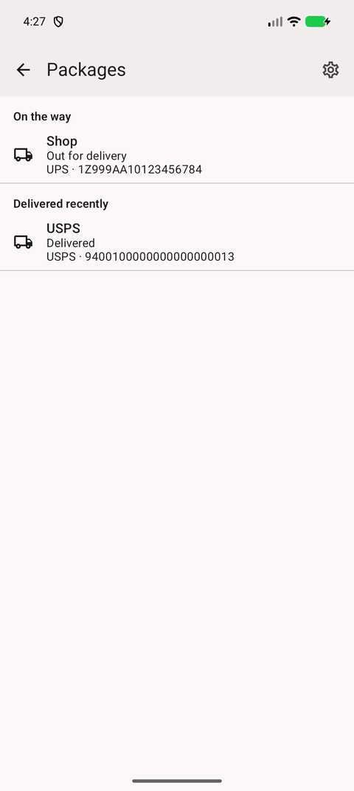 | 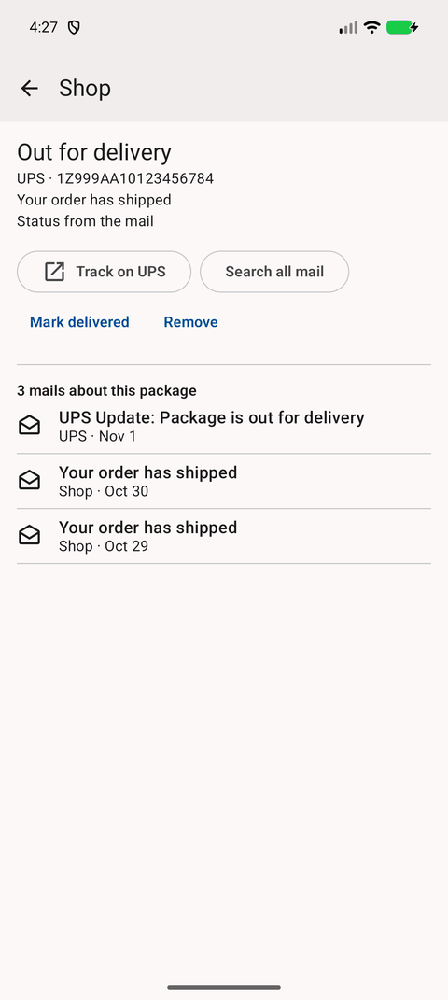              | 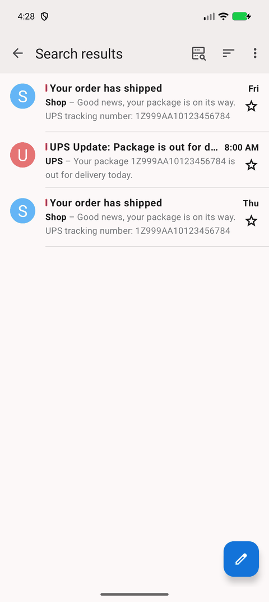 |
| Carrier tracking accounts                                                                                            | Trips                                                                                                                      | Drawer                                                                                                                   |
| 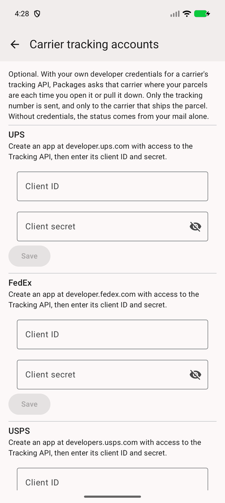        | 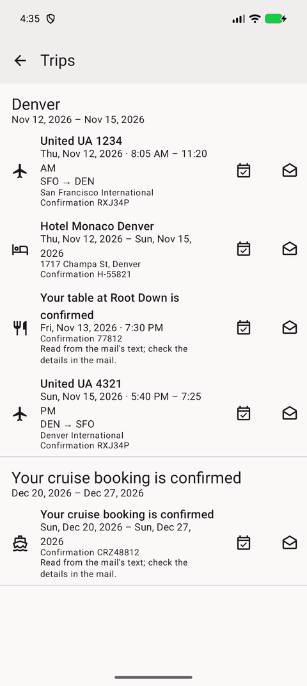                      | 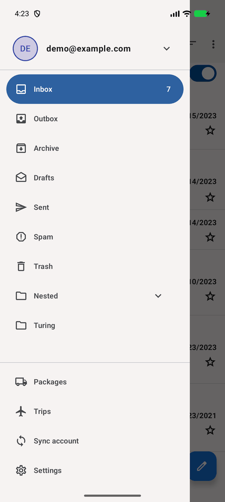       |
| Settings                                                                                                             | Copy code, blocked trackers                                                                                                | Sign-in link                                                                                                             |
| 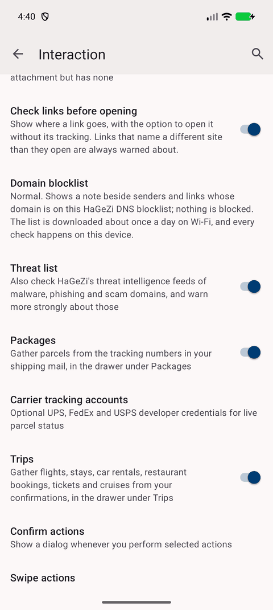      | 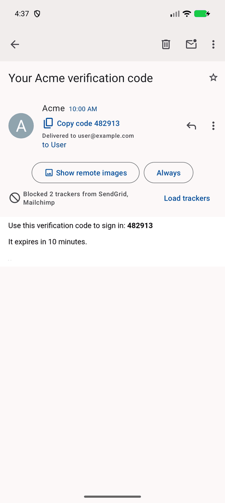 | 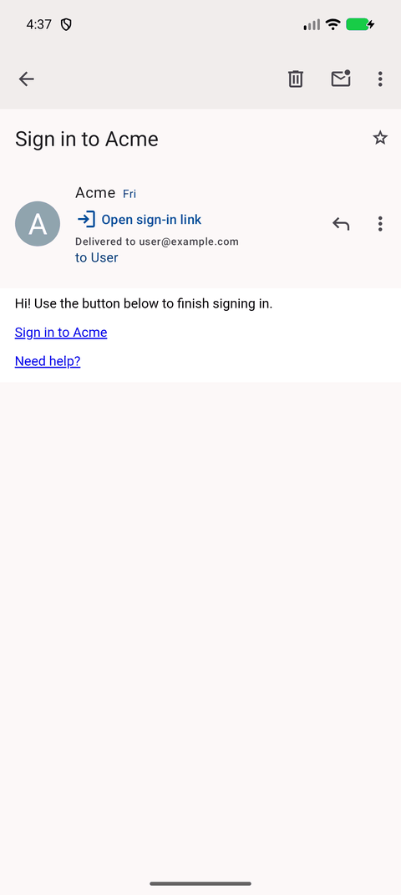                               |
| Track a package                                                                                                      | Attachments from a sender                                                                                                  |                                                                                                                          |
| 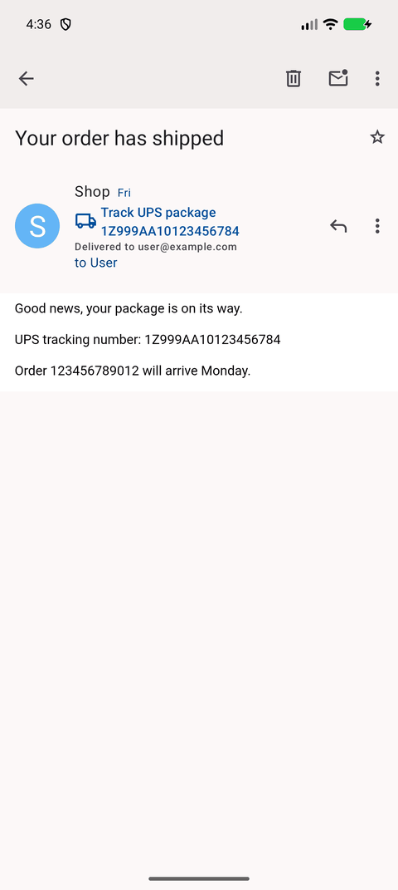                     | 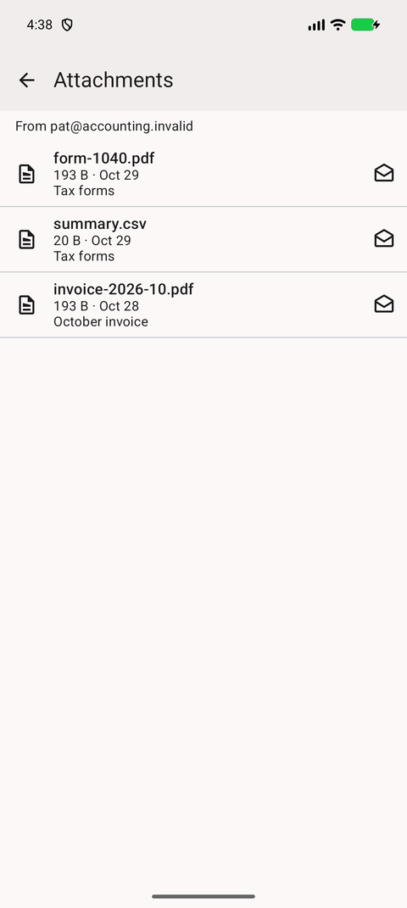                      |                                                                                                                          |

